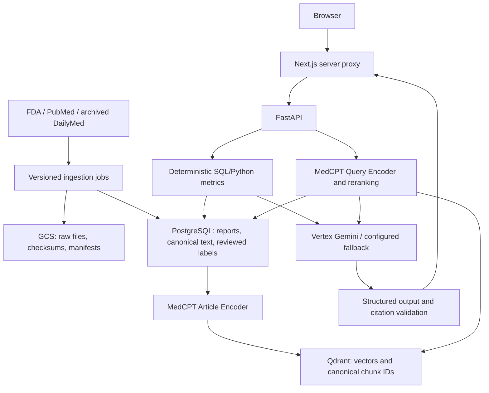

# PharmaGuard AI


> **GitHub source snapshot:** This repository publishes the source of the deployed
> PharmaGuard AI **0.1.1** release, exported from GitLab commit
> [`20715847`](https://gitlab.com/gitlab-ai-hackathon/transcend-october-2026/22263020/showcase/-/commit/20715847a6fa829864f7b5796d0f8f6c9db8fafd).
> [Watch the demo](https://youtu.be/J2ItTcts2ek) or
> [open the live application](https://pharmaguard-web-dfthmgvvaa-el.a.run.app).
> GitLab remains the release and CI/CD system of record. The checked-in GitLab pipeline
> and Duo configuration are preserved here for inspection; publishing this repository
> does not configure GitHub Actions or deploy any service. See
> [source provenance](docs/source-provenance.md) for the snapshot boundaries.

**An evidence-grounded drug-safety workspace with supervised AI release gates.**

PharmaGuard combines real adverse-event reports, archived drug labels, and biomedical
literature in a conversational interface. PostgreSQL calculates reporting signals, MedCPT
retrieves evidence, and a language model produces a cited explanation. GitLab CI checks
retrieval quality alongside software correctness before packaging and deployment. One
supervised GitLab Duo flow reviews actual release artifacts for a human decision.

**For drug-safety signal investigation and evidence review only. Not medical advice and
not proof of causality.** This research prototype has a bounded corpus and shared anonymous
usage budget.

- [Public chatbot](https://pharmaguard-web-dfthmgvvaa-el.a.run.app) — no sign-in required.
- [VM staging preview](https://pharmaguard-vm-preview-dfthmgvvaa-el.a.run.app).
- [GitLab project and pipelines](https://gitlab.com/gitlab-ai-hackathon/transcend-october-2026/22263020/showcase).
- [Verification evidence and limitations](docs/verification.md).
- [Operations Wiki](https://gitlab.com/gitlab-ai-hackathon/transcend-october-2026/22263020/showcase/-/wikis/Home), [work board](https://gitlab.com/gitlab-ai-hackathon/transcend-october-2026/22263020/showcase/-/boards/11699269), and [verified release](https://gitlab.com/gitlab-ai-hackathon/transcend-october-2026/22263020/showcase/-/releases/v0.1.0).
- [GitLab reports, security and monitoring operations](docs/gitlab-operations.md).

## Contents

- [Application](#application)
- [Architecture](#architecture)
- [Repository structure](#repository-structure)
- [Local setup](#local-setup)
- [Configuration and secrets](#configuration-and-secrets)
- [Real-data ingestion](#real-data-ingestion)
- [Deterministic metrics](#deterministic-metrics)
- [Retrieval and synthesis](#retrieval-and-synthesis)
- [API](#api)
- [Memory and caching](#memory-and-caching)
- [Testing and evaluation](#testing-and-evaluation)
- [GitLab CI and Duo](#gitlab-ci-and-duo)
- [Deployment and rollback](#deployment-and-rollback)
- [Security and logging](#security-and-logging)
- [Troubleshooting](#troubleshooting)
- [Documentation and license](#documentation-and-license)

## Application

The initial scope is **semaglutide / pancreatitis**. This investigation scenario makes no
claim about a causal relationship.

1. Enter a question, with optional drug, event and historical cutoff filters.
2. Inspect the generated answer alongside deterministic case counts, ROR and PRR.
3. Open the evidence panel for exact source passages, versions, dates and citations.
4. Follow source links to PubMed or version-specific DailyMed label pages.
5. Review actual coverage, availability gaps, warnings and insufficient-evidence explanations.

Example: “What does the retrieved evidence say about semaglutide and pancreatitis?”
Set explicit drug/event filters when a question is ambiguous. Entity resolution uses canonical
names and reviewed aliases. An unresolved pair inferred from the question produces unavailable
metrics with a reason; an unknown or ambiguous explicit filter is rejected for correction.

The responsive workspace includes keyboard interaction, mobile layouts, loading/retry states
and five recent conversation exchanges. Empty installations report setup required until a
real dataset is published. Production responses never substitute test fixture answers.

## Architecture



| Component | Responsibility |
| --- | --- |
| Next.js / TypeScript | Chat, signal card, evidence inspection, session cookie, server-only proxy |
| FastAPI / Python 3.12 | Entity resolution, deterministic metrics, retrieval and synthesis |
| PostgreSQL / Cloud SQL | Authoritative facts, canonical evidence, lineage, evaluation labels and sessions |
| Google Cloud Storage | Immutable source artifacts, manifests, frozen snapshots and reports |
| Qdrant | Rebuildable dataset-specific 768-dimensional cosine index |
| MedCPT | Paired Query/Article encoders and a bounded Cross-Encoder reranker |
| Vertex AI | Primary structured synthesis; configurable Groq/OpenAI fallbacks |
| GitLab CI / Duo | Blocking checks, immutable packaging, deployment evidence, supervised review |
| Terraform / Compute Engine / Cloud Run | Persistent VM hosting behind a Cloud Run HTTPS entry point |

The online request path does not parse raw GCS files. Every vector ID resolves to PostgreSQL
text and passes dataset/date checks before use. Missing canonical records are integrity
errors. Published datasets are immutable. Publication switches the active pointer only after
canonical loading and indexing succeed.

## Repository structure

```text
apps/
  api/src/pharmaguard/          FastAPI, facts, retrieval, synthesis, sessions
  web/                         Next.js UI, API proxy, frontend tests
ingestion/                     Source adapters, loading, indexing
evaluation/                    Snapshot export/restore, deterministic gates, live judge
migrations/                    Alembic schema migrations
config/retrieval.json          Versioned non-secret retrieval policy
infra/
  terraform/environments/      Production Terraform root
  terraform/modules/           Reusable VM/network module
  vm/                          VM release controller
  edge/                        Cloud Run HTTPS forwarding image
  *.py, *.sh, *.ps1             Bootstrap and operational commands
.gitlab/
  ci/                          Validation through governance jobs
  duo/                         One supervised release flow and hosted setup
ci/                            Pipeline helpers and artifact policies
scripts/                       Local setup and shutdown
tests/                         Backend unit and real-dependency integration tests
docs/                          Setup, architecture, operations and verification
skills/rag-release-safety/     Release-review policy
```

Python and frontend versions are resolved in `uv.lock` and `apps/web/pnpm-lock.yaml`.
Terraform's provider lockfile is committed. Generated data, model weights, state, saved plans,
local tools and credentials are excluded from Git and image build contexts.

## Local setup

### Prerequisites

- Git, `uv`, Python 3.12, Node.js 24 and pnpm 12.14.0.
- Docker Desktop with a working Linux engine for PostgreSQL and Qdrant.
- Google Cloud SDK and access to the local configuration plus its referenced secrets.
- Network access for initial packages, pinned models, ingestion and live providers.

A fresh checkout does not include public credentials or a preloaded database. Full operation
requires an authorized Secret Manager configuration and real data.

### Authenticate and install

Run from the repository root in PowerShell:

```powershell
gcloud.cmd auth login --update-adc
gcloud.cmd auth application-default set-quota-project YOUR_PROJECT
$env:APP_CONFIG_SECRET='projects/YOUR_PROJECT_NUMBER/secrets/pg-config-local/versions/YOUR_VERSION'
powershell.exe -NoProfile -ExecutionPolicy Bypass -File scripts/setup.ps1
```

`APP_CONFIG_SECRET` is a resource reference, not a credential. Use a numeric pinned version.
The local configuration must target the local database/Qdrant host ports and local password
secret, with required provider/session settings. Cloud runtime and ingestion configurations
use different identities and permissions. See [setup details](docs/setup.md).

### Start the complete stack

```powershell
uv run python infra/run_compose.py up --build -d
uv run python infra/run_compose.py ps
```

The launcher loads secrets into process memory, starts dependencies, runs migrations, then
starts both apps. The API image includes pinned model weights; its first build can take several
minutes. It retains existing database/index volumes.

| Service | Local URL |
| --- | --- |
| Chat workspace | http://127.0.0.1:3000 |
| API health | http://127.0.0.1:8000/health |
| API readiness | http://127.0.0.1:8000/ready |
| OpenAPI documentation | http://127.0.0.1:8000/docs |

An empty database is not ready for investigations until ingestion publishes a dataset.
Health establishes process liveness; readiness also checks the active dataset/index. Neither
replaces a real cited investigation.

### Optional source development

For source reloads, start only dependencies and run apps in separate terminals. Use the same
local configuration reference and avoid ports already occupied by the complete stack.

```powershell
uv run python infra/run_compose.py up -d postgres qdrant
uv run alembic upgrade head
uv run uvicorn pharmaguard.main:app --reload --host 127.0.0.1 --port 8000
```

In a second PowerShell terminal:

```powershell
Set-Location apps/web
npm.cmd exec --yes --package=pnpm@12.14.0 -- pnpm dev
```

The development web proxy defaults to `http://127.0.0.1:8000`. ADC authorizes local Secret
Manager and Vertex requests. The setup guide also covers native Windows dependencies and
loopback Cloud SQL Auth Proxy access.

### Shutdown

Stop foreground apps with Ctrl+C. Stop containers with:

```powershell
powershell.exe -NoProfile -ExecutionPolicy Bypass -File scripts/stop.ps1
```

Persistent PostgreSQL and Qdrant volumes remain. Volume deletion is not a routine shutdown.

## Configuration and secrets

`pharmaguard.config.Settings` is the typed backend configuration boundary. A pinned
configuration secret contains model settings and references to separate credential secrets.
ADC or the deployed identity loads values into memory. No `.env` file is required or created,
and no service-account JSON key is needed.

| Setting | Purpose |
| --- | --- |
| `APP_CONFIG_SECRET` | Pinned Secret Manager configuration reference |
| `AS_OF_DATE`, `LOOKBACK_MONTHS` | Ingestion date and rolling source window |
| `RAW_STORE`, `GCS_BUCKET` | Local raw storage or immutable GCS storage |
| `DB_HOST`, `DB_PORT`, `DB_NAME`, `DB_USE_TCP` | Explicit local/container/SQL proxy transport overrides |
| `QDRANT_URL`, `QDRANT_COLLECTION` | Index endpoint and collection namespace |
| `GIT_SHA` | Build identity for version metadata, logs and cache invalidation |
| `API_INTERNAL_URL`, `API_AUTH_MODE` | Server-only Next.js upstream and service-authentication mode |

Credentials, live answer/judge model settings and session signing keys belong in the Secret
Manager configuration chain. Do not put keys in frontend variables, CLI arguments, logs,
artifacts or screenshots. `config/retrieval.json` holds the reviewable retrieval policy.

## Real-data ingestion

The default window is 24 months ending on the configured UTC date. Discovery selects available
completed FDA releases overlapping it. Metrics retain the full comparison population from
those releases, rather than loading only reports about the investigated drug.

With dependencies and the local configuration available:

```powershell
uv run pharmaguard-ingest discover-faers .data/releases.json
# Review source URLs, release availability dates and the intended window before loading.
uv run pharmaguard-ingest run --release-manifest .data/releases.json
uv run pharmaguard-ingest status
```

For explicit stages:

```powershell
$dataset = uv run pharmaguard-ingest create
uv run pharmaguard-ingest load-faers $dataset .data/releases.json
uv run pharmaguard-ingest load-evidence $dataset --pubmed-limit 40 --label-limit 3
uv run pharmaguard-ingest index $dataset
uv run pharmaguard-ingest publish $dataset
```

Resume with `run --dataset-id DATASET_ID --release-manifest PATH`. An identical completed
FAERS stage can be reused. Published datasets reject mutation; create a new staging dataset
for refreshed data or an index rebuild with changed model lineage. Stable document/chunk IDs,
idempotent upserts and explicit stage failures support recovery.

Downloads stream to immutable content-addressed paths with checksums and manifests. Cloud
loading uses GCS and a separate ingestion identity. DailyMed uses archived SPL versions;
current text cannot replace an unavailable historical label. PubMed publication, availability
and XML revision dates are treated conservatively. Missing quarters remain visible gaps.

The reviewed dataset ending **17 October 2026** contains seven FDA releases from **2024 Q4
through 2026 Q2**, 2,847,845 report-version rows, 39 PubMed records, six archived DailyMed
versions and 561 canonical chunks. Report-version rows are not deduplicated case counts.
2026 Q3 was unavailable at discovery. Literature/labels are a bounded subset, not comprehensive.
Use the live response's dataset identity and coverage for each investigation.

## Deterministic metrics

PostgreSQL selects the latest case version known at the cutoff, applies eligible deletions
and the reporting window, then counts distinct reports. Primary/secondary suspect drug roles
(`PS`/`SS`) define target exposure. Drug/reaction joins cannot multiply a report's contribution.

| Report population | Target event present | Target event absent |
| --- | --- | --- |
| Target suspect drug present | `a` | `b` |
| Target suspect drug absent | `c` | `d` |

```text
case_count = a
ROR = (a × d) / (b × c)
PRR = [a / (a + b)] / [c / (c + d)]
```

Tested SQL/Python owns these numbers. Invalid denominators, absent comparison data or unresolved
entities produce nullable metrics and a reason. The LLM never calculates them. These reporting
measures have reporting biases and no population exposure denominator; they do not establish
incidence or causality.

## Retrieval and synthesis

Queries use `ncbi/MedCPT-Query-Encoder`; evidence uses its paired
`ncbi/MedCPT-Article-Encoder`. Revisions are pinned and recorded in ingestion/evaluation
metadata. Article inputs preserve title/body structure. Qdrant uses cosine similarity over
768-dimensional vectors and returns canonical UUIDs.

The current policy combines dense and bounded exact-term candidates, validates canonical
records, and reranks a bounded pool with a pinned float32 `ncbi/MedCPT-Cross-Encoder`.
Short-abstract context and eligible regulatory warning context retain useful caveats. The final
default budget is **five evidence chunks**. Temporal eligibility includes source publication,
version availability, the dataset window and requested cutoff.

Vertex AI Gemini synthesizes structured cited paragraphs, with configured Groq/OpenAI
fallbacks for eligible provider failures. The server checks every citation against supplied
evidence. Citation-integrity failures do not trigger a fallback that hides invalid output.
Insufficient support requires abstention. A valid citation ID alone does not establish semantic
support; separate reviewed answer points and live judging address that additional question.

## API

The browser uses the Next.js proxy under `/api/`. Backend routes are:

| Method | Backend path | Purpose |
| --- | --- | --- |
| GET | `/health` | Process liveness |
| GET | `/ready` | Database, dataset and compatible nonempty index readiness |
| GET | `/version` | App/Git identity, retrieval policy and encoder revisions |
| POST | `/session` | Create/renew an anonymous conversation when enabled |
| POST | `/investigate` | Deterministic facts, eligible evidence and cited synthesis |

Investigation request:

```json
{
  "question": "What does the evidence say about semaglutide and pancreatitis?",
  "drug": "semaglutide",
  "event": "pancreatitis",
  "cutoff_date": "2026-10-17"
}
```

Only `question` is required (3–2,000 characters). The cutoff must be within the dataset window.
Responses include `answer`, `facts`, `citations`, `retrieved_evidence`, `retrieved_evidence_ids`,
`retrieval`, `data_window`, `warnings`, `insufficient_evidence`, `synthesis`, `request_id`, and
session/cache metadata. Source URLs/text/dates come from canonical storage, not model output.

Errors use `{"error":{"code":"…","message":"…","request_id":"…"}}` and appropriate HTTP
statuses. These distinguish invalid input, unavailable dependencies, session expiry/busy state
and exhausted budget. Use the request ID for diagnosis. The proxy allows known endpoints,
requires same-origin POSTs, bounds request bodies and manages the HttpOnly cookie; it is not
an unrestricted API relay.

## Memory and caching

- PostgreSQL retains the **newest five complete user/assistant exchanges**; oldest exchanges
  are evicted. History provides bounded context, not replacement evidence.
- A signed one-hour JWT is held in an HttpOnly, SameSite=Strict cookie. HTTPS sets Secure.
  Renewal occurs before requests and every 55 minutes, within a 24-hour absolute session lifetime.
- Only explicit follow-ups inherit the preceding drug/event/cutoff. Independent questions do not.
- Each session has up to five successful exact-request cache entries, valid at most one hour.
  Keys include context, dataset, retrieval/model configuration and application SHA.
- Hits revalidate canonical text, dates and citations and return a fresh request ID. They avoid
  retrieval/model calls. Errors and insufficient-evidence answers are not cached.
- Row locking rejects overlapping investigations in the same session. Sessions are isolated;
  cache hits still consume the shared admission budget.

Anonymous sessions are not user authentication. Deterministic evaluation bypasses memory/cache
so reuse cannot conceal retrieval regressions. See [session retention and behavior](docs/sessions.md).

## Testing and evaluation

### Software checks

From the repository root, with PostgreSQL/Qdrant running for integration:

```powershell
uv run ruff check .
uv run ruff format --check .
uv run pytest
$env:RUN_INTEGRATION='1'
uv run pytest -m integration
Remove-Item Env:RUN_INTEGRATION
```

Frontend checks:

```powershell
Push-Location apps/web
npm.cmd exec --yes --package=pnpm@12.14.0 -- pnpm lint
npm.cmd exec --yes --package=pnpm@12.14.0 -- pnpm typecheck
npm.cmd exec --yes --package=pnpm@12.14.0 -- pnpm test
npm.cmd exec --yes --package=pnpm@12.14.0 -- pnpm exec playwright install chromium
npm.cmd exec --yes --package=pnpm@12.14.0 -- pnpm test:e2e
npm.cmd exec --yes --package=pnpm@12.14.0 -- pnpm build
Pop-Location
```

Tests cover formulas, duplicate reports, temporal boundaries, citation/canonical integrity,
ingestion, dependency failures, session isolation, retry behavior, and desktop/mobile citation
navigation. Synthetic fixtures are confined to tests.

### Frozen real-corpus gate

Ten source-reviewed cases and independently derived fact expectations are exported with
canonical text, provenance and the full comparison population. The compressed snapshot is
versioned and SHA256-pinned outside Git. CI uses `CI_JOB_TOKEN` to fetch it from the GitLab
Generic Package Registry and verifies the checksum. An immutable prepared database image
starts a fresh disposable instance containing that complete population. A separate runtime
image includes locked dependencies and pinned model weights. Every run verifies input identity,
canonical evidence and row counts, rebuilds a separate index, and calls current-commit
production fact/retrieval services. No report, ranking or fact result from an earlier job is reused.
Checksum-pinned article vectors can accelerate unchanged corpus encoding; changed encoder
code, dependencies or text use current inference instead. Query encoding and ranking always
run afresh. Four bounded case workers run on an isolated GitLab runner, never on the app VM.

| Gate | Required result |
| --- | --- |
| Recall@5 | At least 0.80 for every case |
| Critical evidence | All critical passages retrieved |
| Temporal leakage | Zero ineligible source versions |
| Citation integrity | Zero invalid canonical citations |
| Deterministic facts | Exact agreement with reviewed expectations |

Against a database already containing the benchmark dataset:

```powershell
uv run pharmaguard-eval run .data/evaluation/snapshot.zip --expected-sha256 APPROVED_SHA256
```

For a separately configured **empty disposable evaluation database**, add `--restore-data`.
Restore rejects existing datasets. Never target the live database. Against a verified prepared
input database, use `--prepared-data` instead. The gate writes `evaluation/report.json`, including
timings and input mode, and returns nonzero on failure. Full input preparation previously took
around 20–25 minutes per run; the prepared-input path moves that work to a one-time build per
snapshot/schema. Cold image pulls, runner scheduling and actual gate execution still contribute
to elapsed CI time. See the evaluation guide for preparation and runtime measurements.

### Separate live synthesis judge

```powershell
uv run pharmaguard-eval judge .data/evaluation/snapshot.zip
```

This requires live credentials and incurs provider usage. A separately configured model
assesses real answers against reviewed answer points for groundedness, correctness, coverage
and safety. The identical answer model cannot judge its own output. LLM judgment supplements
deterministic gates; it never rewrites labels or establishes clinical truth. See
[benchmark preparation and evaluation](docs/evaluation.md).

## GitLab CI and Duo

```text
validate → test → secure → rag_eval → infrastructure_plan → package
  → infrastructure_apply (manual) → deploy_staging → postdeploy
  → production promotion (manual) → public smoke → final governance (manual)
```

| Stage | Checks or artifacts |
| --- | --- |
| Validate | Python lint/format; frontend lint/type/build; Terraform format/init/validate |
| Test | Backend/frontend unit tests, browser scenarios, real PostgreSQL/Qdrant integration |
| Secure | Python/web dependency audits and repository-content secret scan |
| RAG | Frozen report with dataset, model revisions, policy and commit identity |
| Plan | Saved Terraform plan and policy-checked sanitized resource/action summary |
| Package | SHA-tagged API/web/edge images resolved to immutable digests in `images.env` |
| Apply | Manual saved-plan application with locking and no-delete policy |
| Staging | Additive migrations, VM release, readiness and reviewed cited-investigation smoke |
| Govern | Explicit public promotion, public smoke and final human decision |

Feature-branch gates lack deployment credentials. Protected `main` uses short-lived GitLab
OIDC credentials through GCP Workload Identity Federation, restricted to the official namespace,
project and protected branch. Packaging cannot precede blocking quality/security checks.

Protected `DEPLOY_TARGET=vm` selects the VM path; the legacy Cloud Run application path remains
available. CI variables contain resource IDs, pinned secret references and reviewed smoke
expectations, not runtime key values. Full plans are maintainer-restricted;
`terraform:evidence` publishes only policy-checked resource addresses/actions.

The single supervised Duo flow under `.gitlab/duo/flows/` inspects the MR, real job logs,
frozen report, image identities, sanitized plan, deployment events and smoke results. Catalog
registration and project enablement are separate GitLab actions; YAML alone does not activate
it. The current success-path flow cannot edit product code, CI, tests, benchmarks or security
settings, merge MRs or approve production. Failures become release blockers. Future repair
work requires a separately requested task.

Use actual pipeline/session URLs as evidence. Green feature checks do not establish WIF,
packaging or staging success. An owner-operated cloud deployment is distinct from a GitLab-run
deployment. [Verification status](docs/verification.md) separates these results.

## Deployment and rollback

Terraform owns application VM/network/supporting resources under
`infra/terraform/environments/production`. Existing Cloud SQL, raw storage, registry and Qdrant
are reused. Secret payloads are not Terraform resources/data sources. A private, versioned
GCS bucket holds state with locking.

The VM hosts non-root, resource-bounded API/web containers and the Cloud SQL Auth Proxy.
Subsequent releases update the **same VM and disk** by immutable digest. Packaging is serialized,
and retrying the same commit reuses images already published for that SHA. Deletion protection,
`prevent_destroy` and a no-delete/replacement policy protect that identity. Two application
slots allow readiness checks before routing changes. Deployments preserve the database and
avoid automatic infrastructure upgrades.

The release controller removes failed candidate containers and bounds local application-image
retention to production, previous production and current staging releases. Cleanup is limited to this application's API/web
repositories and protects images referenced by any container. It does not prune volumes or
other workloads. A disk-reserve check rejects unsafe new pulls instead of filling the disk.

The public HTTPS address remains Cloud Run. After explicit human promotion, the edge forwards
over a private VPC path to production listener `8080`. The staging preview uses its own subnet
and listener `8081`, so a staging release cannot retarget or stop production. Only the
corresponding subnet reaches each listener;
SSH uses IAP/OS Login. Backend containers have no public host ports. The existing public
service remains on its prior revision until promotion is approved.

The stop timer preserves service through **19 November 2026 IST**, powering off at
**20 November 2026 00:00 IST** (`2026-11-19T18:30:00Z`). It preserves the disk/data. A running
VM incurs continuous compute charges; stopping it does not stop SQL or remove storage charges.
This is a single-machine deployment with capacity and availability limits. Cloud Run app
services default to zero minimum instances and have a different cost model.

Staging must prove deployed SHA/digests, readiness, dataset identity and a reviewed real
investigation with required evidence IDs. Missing expectations or invalid citations fail the
smoke, which has a 120-second HTTP timeout and a strict 60-second overall performance limit. Public
promotion and final governance remain manual.

The release controller retains the previous manifest and restores routing if a switch fails.
Explicit rollback stages the recorded previous production images/configuration; a human then
approves promotion. It never downgrades the schema or deletes data. Additive schemas must support retained app versions. Dataset rollback
is a separate active-pointer change with preserved canonical rows/collections. Cloud Run
rollback restores traffic to a previous ready revision.

See [deployment and rollback commands](docs/deployment.md) and
[Terraform/VM operations](docs/terraform-vm.md). Never delete SQL, buckets or volumes to recover
an application revision.

## Security and logging

Runtime, ingestion, evaluation, web and deployment use separate identities. The API can read
canonical tables and write its session/budget state; ingestion owns canonical loading. The
Cloud Run web identity invokes the private API but cannot read model/database secrets.
The VM web container is blocked from metadata identity access. Host root remains trusted.

Additional controls include parameterized SQL, typed bounded input, server-side service
authentication, same-origin POST checks, a nonce-based Content Security Policy, text-only
model rendering, secure session cookies and a PostgreSQL shared daily investigation cap.
Anonymous access can still exhaust budget or attract abuse; these controls do not promise
complete security or high availability.

JSON logs correlate requests, retrieval candidates/policy, cache outcomes, ingestion runs and
manifests, and deployment events with request/run IDs and Git identity. They exclude keys,
tokens, full prompts, arbitrary exception payloads and environment dumps. Cloud Run captures
stdout; VM journald and the Ops Agent forward telemetry. Duo receives sanitized artifacts and
job links, never unrestricted host logs, state, JWTs or secret payloads.
See [observability](docs/observability.md).

## Troubleshooting

| Symptom | Action |
| --- | --- |
| Docker unavailable | Start Docker Desktop and verify its Linux engine/virtualization prerequisites |
| Secret configuration cannot load | Verify ADC account, quota project, pinned version and access to all referenced secrets |
| Health passes, readiness fails | Check migrations, published dataset, nonempty index and embedding compatibility |
| Empty setup has no answers | Complete real ingestion; evaluation restore belongs in a separate disposable database |
| Metrics unavailable | Specify one recognized pair; inspect coverage, cutoff and denominator reason |
| Historical evidence missing | Check availability/revision dates; current text cannot replace missing historical versions |
| Session expired/busy | Start a new session after expiry; let the active request finish before retrying |
| Budget exhausted | Inspect the shared cap; a new session does not reset it |
| Slow first start | Allow model preload; use pinned cached/baked weights and inspect sanitized logs |
| RAG fails while tests pass | Inspect missing critical evidence/facts/date checks; preserve labels and thresholds |
| Packaging absent on an MR | Deployment requires protected default-branch context and successful gates |
| Pipeline waiting manually | Review concrete evidence and obtain the required approval; do not bypass the job |

## Documentation and license

| Guide | Contents |
| --- | --- |
| [Setup](docs/setup.md) | Authentication, dependencies, ingestion and SQL inspection |
| [Architecture](docs/architecture.md) | Directory responsibilities and data boundaries |
| [Deployment](docs/deployment.md) | GCP inventory, bootstrap, identities and rollback |
| [Terraform / VM](docs/terraform-vm.md) | Private networking, persistent releases, expiry and CI |
| [Evaluation](docs/evaluation.md) | Reviewed labels, frozen snapshots, blocking gates and live judging |
| [Sessions](docs/sessions.md) | Memory, renewal, exact-request cache and retention |
| [Observability](docs/observability.md) | JSON events, Cloud Logging and release evidence |
| [Security review](docs/security-review.md) | Runtime hardening, retained findings and release policy |
| [License evidence](compliance/README.md) | Registry declarations and dependency license review |
| [Verification](docs/verification.md) | Observed checks and remaining acceptance work |

Follow [AGENTS.md](AGENTS.md), keep facts deterministic and preserve provenance. Run relevant
local checks and authoritative CI. Never weaken labels, thresholds, tests or approvals to turn
a failing product release green.

Application code uses the [MIT License](LICENSE). Downloaded models and public-source data
retain their upstream terms; this application license does not relicense them. Credentials,
model weights and raw corpora are not distributed in Git.
