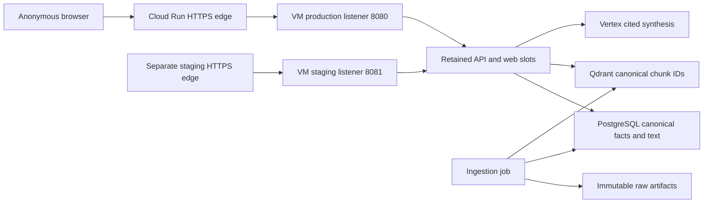

# Architecture and operations

The public web interface is intentionally anonymous, with a shared budget. The API stays private.
Separate source subnets and listeners isolate staging routing from the production pin. Both
slots share one VM's resources and database; this is not high availability or host-failure isolation.

Canonical text, dates and metrics live in PostgreSQL. Qdrant is rebuildable. Every retrieved
chunk resolves back to canonical, temporally eligible text. GCS retains raw inputs and manifests.
Session memory keeps the newest five complete exchanges. Identical eligible session requests
can reuse cached responses. Secret Manager provides configuration and credentials.

Detailed procedures:

- [Setup](https://gitlab.com/gitlab-ai-hackathon/transcend-october-2026/22263020/showcase/-/blob/main/docs/setup.md)
- [Deployment](https://gitlab.com/gitlab-ai-hackathon/transcend-october-2026/22263020/showcase/-/blob/main/docs/deployment.md)
- [VM routing, rollback and expiry](https://gitlab.com/gitlab-ai-hackathon/transcend-october-2026/22263020/showcase/-/blob/main/docs/terraform-vm.md)
- [Evaluation](https://gitlab.com/gitlab-ai-hackathon/transcend-october-2026/22263020/showcase/-/blob/main/docs/evaluation.md)

Recover from partial Terraform apply with a fresh reviewed plan; do not force an old plan,
unlock active state, delete the VM or broaden CI to Owner/Editor. Reuse the same VM and keep
two bounded application slots. Production rollback preserves canonical data and the disk.
The scheduled November expiry stops the VM rather than deleting data.
